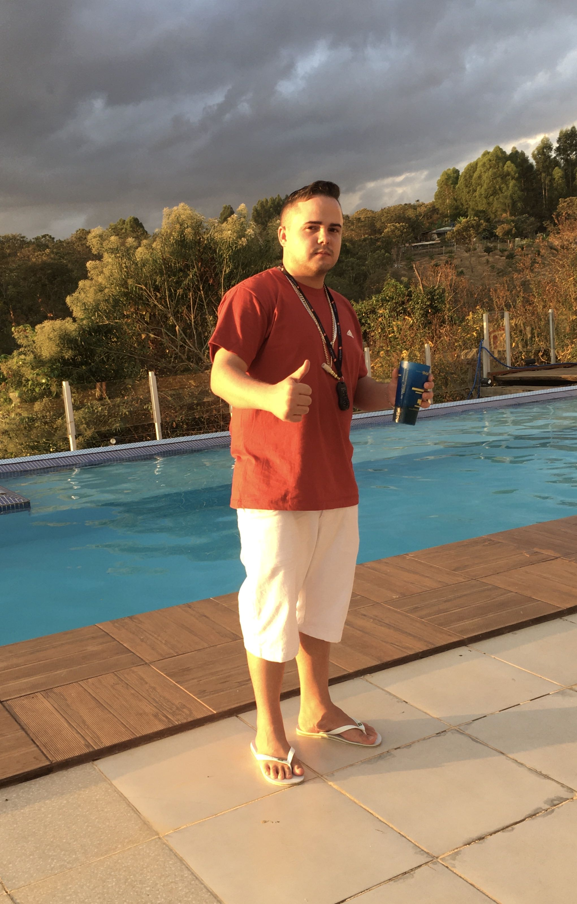

# portfolio-perfil

codigo do index.html[index.html](https://github.com/user-attachments/files/35422901/index.html)
<!DOCTYPE html>
<html lang="pt-BR">
<head>
    <meta charset="UTF-8">
    <meta name="viewport" content="width=device-width, initial-scale=1.0">
    <title>Luis Felipe | Portfólio</title>
    <link href="css/style.css" rel="stylesheet" type="text/css">
</head>
<body>
    <header>
        <a href="#" class="logo">Luis Felipe</a>
        <nav class="navbar">
            <ul>
                <li><a href="#about">Sobre</a></li>
                <li><a href="#work">Trabalho</a></li>
                <li><a href="#contact">Contato</a></li>
            </ul>
        </nav>
    </header>

    <main>
        <!-- Seção Principal com a sua foto menor -->
        <section id="hero">
            
            <h2>Luis Felipe Ferreira de Aguiar</h2>
            
Itapuã - Brasília/DF

        </section>

        <!-- Seção Sobre Mim -->
        <section id="about">
            <h1>Sobre Mim</h1>
            
Olá! Me chamo <strong>Luis Felipe Ferreira de Aguiar</strong> e moro no <strong>Itapuã</strong>. Moro com meu pai, que é meu grande parceiro de dia a dia, e carrego comigo com muito carinho e saudade as lembranças e os ensinamentos da minha mãe, que já é falecida. Nossa casa também é alegrada pelas minhas <strong>duas cachorras</strong>, que são ótimas companheiras.

            
Tenho uma rotina bastante ativa e dedicada: durante o dia trabalho como <strong>repositor de mercado</strong> e à noite atuo como <strong>motoboy</strong>. Quando tenho tempo livre para descansar e recarregar as energias, gosto muito de <strong>jogar no PC</strong> e <strong>escutar músicas</strong>.

        </section>

        <!-- Seção Rotina / Trabalho -->
        <section id="work">
            <h1>Minha Rotina</h1>
            

                

                    <h2>Repositor de Mercado</h2>
                    
Atuação no período diurno com organização de gôndolas, controle de estoque, reposição de produtos e atendimento.

                

                

                    <h2>Motoboy</h2>
                    
Atuação no período noturno realizando entregas com agilidade, responsabilidade no trânsito e pontualidade.

                

                

                    <h2>Tempo Livre</h2>
                    
Nos momentos de descanso, meu foco é relaxar jogando no computador e curtindo boas músicas.

                

            

        </section>

        <!-- Formulário de Contato -->
        <section id="contact">
            <h1>Contato</h1>
            <form>
                <label>Nome
                    <input type="text" name="nome" required>
                </label>
                <label>E-mail
                    <input type="email" name="email" required>
                </label>
                <label>Mensagem
                    <textarea name="Mensagem" rows="5" required></textarea>
                </label>
                <button type="submit">Enviar</button>
            </form>
        </section>
    </main>

    <footer>
        
&copy; 2026 Todos os Direitos Reservados
            :: Desenvolvido por:
            <a href="mailto:felipe1588luis@gmail.com">felipe1588luis@gmail.com</a>
        

    </footer>
</body>
</html>

codigo css 

[style.css](https://github.com/user-attachments/files/35422908/style.css)
*{
    margin: 0;
    padding: 0;
    box-sizing: border-box;
}

html{
    font-size: 62.5%;
    scroll-behavior: smooth;
}

body{
    font-family: Arial, Helvetica, sans-serif;
    font-size: 1.6rem; 
    color: #1e293b;
}

/* Cabeçalho em Azul Bebê com detalhe em Vermelho */
header{
    background-color: #89CFF0;
    border-bottom: 3px solid #E63946;
    display: flex;
    justify-content: space-between;
    align-items: center;
    box-shadow: 0 2px 10px rgba(0,0,0,0.15);
    position: fixed;
    top: 0;
    left: 0;
    z-index: 1000;
    width: 100%;
    padding: 10px 20px;
    min-height: 60px;
}

.logo{
    font-size: 2.8rem;
    font-weight: 700;
    color: #FFFFFF;
    text-decoration: none;
    text-shadow: 1px 1px 3px rgba(0,0,0,0.3);
}

.navbar ul{
    display: flex;
    list-style: none;
    gap: 8px;
}

.navbar a:link, .navbar a:visited{
    color: #1e293b;
    font-weight: bold;
    font-size: 1.7rem;
    padding: 8px 14px;
    text-decoration: none;
    border-radius: 5px;
    transition: background-color 0.3s ease, color 0.3s ease;
}

.navbar a:hover, .navbar a:active{
    background-color: #E63946;
    color: #FFFFFF;
}

/* Seção Principal (Fundo Branco e Azul Bebê suave) */
#hero{
    background: linear-gradient(180deg, #E0F4FF 0%, #FFFFFF 100%);
    width: 100%;
    min-height: 90vh;
    display: flex;
    flex-direction: column;
    justify-content: center;
    align-items: center;
    text-align: center;
    padding-top: 80px;
}

/* Imagem menor e bem enquadrada */
#hero img{
    width: 180px;
    height: 180px;
    object-fit: cover;
    object-position: top;
    border-radius: 50%;
    border: 4px solid #E63946;
    box-shadow: 0 4px 15px rgba(0,0,0,0.2);
    margin-bottom: 18px;
}

#hero h2{
    font-size: 3rem;
    color: #1e293b;
    margin-bottom: 8px;
}

#hero p{
    font-size: 1.8rem;
    color: #E63946;
    font-weight: bold;
}

h1{
    text-align: center;
    padding: 10px 0 35px;
    font-size: 3.2rem;
    color: #1e293b;
}

section{
    padding: 70px 20px;
    min-height: 85vh;
    display: flex;
    flex-direction: column;
    justify-content: center;
}

/* Seção Sobre em Verde Claro */
#about{
    background-color: #B7E4C7;
}

#about p{
    font-size: 1.9rem;
    line-height: 3.1rem;
    text-align: center;
    max-width: 800px;
    margin: 0 auto;
    padding-bottom: 20px;
}

/* Seção Trabalho em Branco */
#work{
    background-color: #FFFFFF;
    text-align: center;
}

.cards{
    display: flex;
    justify-content: center;
    flex-wrap: wrap;
    gap: 20px;
    max-width: 1000px;
    margin: 0 auto;
}

.card{
    background-color: #E0F4FF;
    border: 2px solid #89CFF0;
    border-top: 5px solid #E63946;
    border-radius: 10px;
    padding: 25px;
    width: 300px;
    box-shadow: 0 4px 15px rgba(0,0,0,0.1);
}

.card h2{
    font-size: 2.2rem;
    margin-bottom: 12px;
    color: #E63946;
}

.card p{
    font-size: 1.6rem;
    line-height: 2.4rem;
    color: #1e293b;
}

/* Seção Contato em Azul Bebê */
#contact{
    background-color: #89CFF0;
    align-items: center;
}

#contact form{
    width: 100%;
    max-width: 400px;
    display: flex;
    flex-direction: column;
    text-align: left;
}

#contact label{
    font-size: 1.6rem;
    margin-bottom: 5px;
    font-weight: bold;
    color: #1e293b;
}

#contact input, #contact textarea{
    width: 100%;
    padding: 12px;
    margin-bottom: 18px;
    font-size: 1.6rem;
    background-color: #FFFFFF;
    border: 2px solid #B7E4C7;
    border-radius: 8px;
}

/* Botão em Vermelho */
#contact button{
    background-color: #E63946;
    color: #FFFFFF;
    font-size: 1.7rem;
    font-weight: bold;
    padding: 12px;
    border: none;
    border-radius: 8px;
    cursor: pointer;
    width: 100%;
    transition: background-color 0.3s ease;
}

#contact button:hover{
    background-color: #b91c1c;
}

/* Rodapé em Verde Claro */
footer{
    background-color: #B7E4C7;
    color: #1e293b;
    padding: 20px;
    text-align: center;
    font-weight: bold;
    border-top: 3px solid #E63946;
}

footer a{
    color: #E63946;
    text-decoration: none;
}

/* Responsivo (Celular) */
@media (max-width: 768px){
    header{
        flex-direction: column;
        gap: 10px;
    }

    .navbar ul{
        flex-wrap: wrap;
        justify-content: center;
    }

    .navbar a:link, .navbar a:visited{
        font-size: 1.5rem;
        padding: 6px 10px;
    }

    #hero{
        padding-top: 120px;
    }

    #hero img{
        width: 150px;
        height: 150px;
    }

    #hero h2{
        font-size: 2.3rem;
    }
}

codigo jss 

[script.js](https://github.com/user-attachments/files/35422921/script.js)

// Menu Responsivo (Mobile)
const menuToggle = document.getElementById('menu-toggle');
const navLinks = document.getElementById('nav-links');

menuToggle.addEventListener('click', () => {
    navLinks.classList.toggle('active');
});

// Fecha o menu ao clicar em um link no celular
document.querySelectorAll('.nav-links a').forEach(link => {
    link.addEventListener('click', () => {
        navLinks.classList.remove('active');
    });
});

// Atualiza o ano atual automaticamente no rodapé
const anoAtual = document.getElementById('ano-atual');
anoAtual.textContent = new Date().getFullYear();
